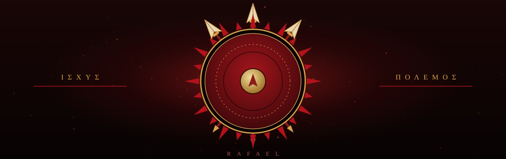

 

*Hold the line.*

 

Full-stack. The whole path, from the schema to the interface to the ground it stands on.

Multi-tenant platforms. Operational software. Built to take the hit.

Most of it is walled off. What stands outside is a study, a fragment, a proof.

 

 

<table align="center">
<tr>
<td width="33%" valign="top" align="center">

### Ⅰ
**BajaSource**

Systems, platforms, infrastructure.

*The interesting parts are not public.*

</td>
<td width="33%" valign="top" align="center">

### Ⅱ
**SoftVet**

Multi-tenant. Separated domains. Records, scheduling, finance, permissions.

*Built to grow without collapsing.*

</td>
<td width="33%" valign="top" align="center">

### Ⅲ
**Direction**

Distributed architecture. Reproducible infrastructure.

*Understandable after it grows.*

</td>
</tr>
</table>

 

  

ΑΡΗΣ

